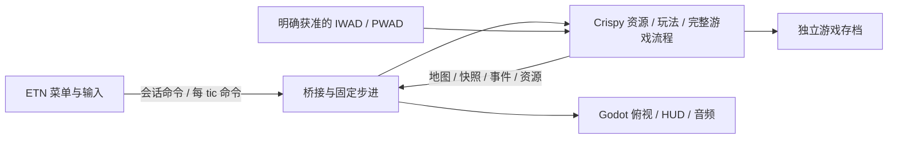

# M0 Runtime Boundary / 完整运行时保留与宿主替换清单

> Date / 日期：2026-11-17。
> Status / 状态：2026-11-17 已完成 M0 的 R01–R15 范围/调用/清理责任审计与最小宿主链路验证，实际处置见源码审计及架构增量；完整模块启用/流程/存档/音频验收仍属 M1。G1 授权待裁定，当前不宣称完整内核移植完成。
> Source / 来源：user（Crispy 选型及不过度通用化的接入原则）、code（本地 Crispy、经典 DOOM 与当前 ETN）。Crispy 锚点基于 `E:/crispy-doom` 的 `35b49519fb4f0360ee1527e8cf0bdf0b6bbfeff2`（7.2-1）；与 7.2 tag 的区别见选型 §8.1，不将源码核对当作运行验证。
> Navigation / 导航：[M0 总览](README.md)；数据语义见[桥接契约](M0_BRIDGE_CONTRACT.md)。

> History / 历史：SUPERSEDED: 2026-11-17，原候选未定的通用清单现落实到 Crispy；原 linuxdoom 参照仍保留在 §4，具体接入方式以实际依赖与探针为准。

## 1. Ownership / 单一玩法真值

> Revision / 修订（2026-11-16，来源：user）：执行 [迁移裁定](M0_LEGACY_MIGRATION.md) §2.1、§3。M0 只运行明确获准的 WAD；2026-11-17 已确认的两种组合与验证用途见[探针清单 §4.1](M0_PROBES_AND_ACCEPTANCE.md#41-approved-wads--当前获准加载清单2026-11-17)，不扩展到其它 WAD。D08 整项 B2/M3，以下通用 PWAD/补丁/资源能力描述是后续边界，不构成 M0 门槛。旧天空与自研导航/刷怪/突袭决策丢弃，首版行为由 Crispy 决定；俯视在 M2 消费 B1 表现基线。

内核持有能改变游戏结果的状态：位置/动量、碰撞、实体生命周期、血量/护甲/弹药、武器与状态机、RNG、机关、进度、资源与补丁解析、存档。Godot 提供输入和显示；桥接负责会话、时序、数据与错误传递。

渲染节点不得反向提交位置/血量来“修正”内核，也不同时运行 ETN 原玩家、敌人、伤害、刷怪或回合逻辑。查询命中预览、鼠标拾取或视觉遮挡时，结果用于表达/生成命令，不取得玩法裁决权。

以下 Mermaid 是职责方向，接口名字仍为设计概念：

## 2. Disposition / 四种处置方式

- **继承**：保留上游规则与数据算法，允许最小构建适配；不能仅复制函数却遗漏其依赖。
- **包装**：保留实现，导出可调用入口、只读状态或事件；尽量不在玩法代码里插入 Godot 对象。
- **平台替换**：用宿主服务替换文件、时钟、输入设备、媒体输出或退出处理；说明可观察行为如何保持。
- **新增**：内核没有提供的 ETN/Godot 桥接和俯视/产品功能；不得把裁剪掉的原有能力重新登记为新增。

一行允许有多种处置，但须分别列改动点、测试与阶段。先实现直接、够用的 Crispy/Godot 接入，允许专用字段和调用；内核与宿主的职责划分不要求做成完全公共 ABI、通用适配器或多个 DLL。是否保留某项 SDL 服务、是否拆库按实际依赖和构建探针决定。固定 tic、所有权、错误与会话清理仍须明确。

## 3. Module Inventory / 必查模块清单

以下路径相对于固定 Crispy 源码，初次从只读 `E:/crispy-doom/` 核对；正式构建源现为本仓 vendor 包。关键调用及完整模块责任已补 [M0_SOURCE_AUDIT.md](M0_SOURCE_AUDIT.md) §2；未实测的完整流程仍明确归 M1。

| ID / 职责 | Crispy 源码定位 | 建议处置与必须保留的语义 | 宿主边界 / 下游 |
|---|---|---|---|
| R01 启动/配置 | `src/doom/d_main.c`、`src/m_config.c`、`src/crispy.c` | 包装初始化；审计 argv/配置默认值，移除对独占主循环的依赖；内核不接管 ETN 进程入口 | Crispy 会话配置与构建信息；M1.1/1.2 |
| R02 WAD/补丁/资源 | `src/w_wad.c`、`src/w_file.c`、`src/d_iwad.c`、`src/deh_main.c` | 最小运行仅装载获准资源；通用装载/覆盖仍复用内核，不另写解析规则，但不作为 M0 前置 | 必需资源与解析后数据 M1.2；D08 全项 B2/M3 |
| R03 地图/空间数据 | `src/doom/p_setup.c`、`p_extnodes.c`、`p_blockmap.c`（后两项同目录） | 继承地图构建、空间索引与 Crispy 实际支持的处理策略；旧严格几何规则单列冲突 | 静态地图导出、装图错误；M1.2/1.5 |
| R04 数值/RNG/顺序 | `src/m_fixed.h`、`src/tables.c`、`src/doom/m_random.c`、`p_tick.c` | 保留选定版本的数值与推进顺序；观察日志不消耗随机数，不为排序快照改变 thinker 次序 | 原始数值用于差分、显示转换单向；M1.3 |
| R05 玩家/实体/碰撞 | `src/doom/p_user.c`、`p_mobj.c`、`p_map.c`、`src/crispy.c` | 继承移动、阻挡、支撑、摩擦、伤害和实体创建/销毁；已有可选原生跳跃，保留其配置与命令路径并验证，不接 ETN 跳跃；Godot 不参与裁决 | tic 命令、实体快照 M1.3；ETN 跳跃表现 B2/M3 |
| R06 武器/战斗/AI/拾取 | `src/doom/p_pspr.c`、`p_enemy.c`、`p_inter.c`、`p_sight.c`、`info.c` | 继承攻击、追踪、视线、自动瞄准、拾取与效果状态；无逐武器重做计划 | 玩家状态、帧/效果/声音；M1.3 |
| R07 特殊线/sector | `src/doom/p_spec.c`、`p_doors.c`、`p_floor.c`、`p_plats.c`、`p_ceilng.c`、`p_lights.c` | 继承触发、计时、贴图/灯光/高度变化；动态几何由表现层跟随 | sector/side 变化、开关/声音；M1.3/M2 |
| R08 游戏动作/流程 | `src/doom/g_game.c`、`d_net.c`、`src/d_loop.c` | 保留新游戏、重生、普通/秘密出口、图间数据传递、胜利/结束、暂停、存读档调度 | 状态机/流程确认命令；M1.4 |
| R09 结算/结束逻辑 | `src/doom/wi_stuff.c`、`f_finale.c` | 分离数据/计时/确认输入与绘制；必要时先保留上游组件，不能仅剩空 stub | 结算统计、阶段与可用操作；M1.4/M2 |
| R10 存档与恢复 | `src/doom/p_saveg.c`、`p_extsaveg.c`、`g_game.c` | 保留基础及扩展存档、target/tracer 恢复；逐项核实归档范围，不假定 RNG 等全部状态已持久化；核查恢复后缓存/引用重建 | 存档封套、路径与恢复快照；M1.4 |
| R11 玩法依赖的渲染数据 | `src/doom/r_data.c`、`r_main.c`、`r_things.c` | 保留被逻辑读取的数据与算法；不得按 `r_*` 前缀整体删除 | 逻辑尺寸与视觉替换尺寸分离；M1.2/1.3 |
| R12 画面/HUD/菜单输入 | `src/doom/r_*.c`、`st_stuff.c`、`hu_stuff.c`、`m_menu.c` | 按调用点拆显示、输入响应与状态逻辑；临时对照显示成本低则保留 | Godot UI/渲染替换；M1 诊断/M2/M3 |
| R13 音频/音乐 | `src/doom/s_sound.c`、`s_musinfo.c`、`src/i_sound.c`、`i_sdlsound.c`、`i_sdlmusic.c` | 审计逻辑事件与设备输出；保留选择/顺序，适配播放后端，不能将重复采样误成重复播放 | 声音句柄、开始/停止/循环；M1.2/1.5/M2 |
| R14 文件/内存/时钟/错误 | `src/i_system.c`、`i_timer.c`、`z_zone.c`、`w_file.c` | 保留必要分配/缓存语义；替换系统服务并拆开失败与进程退出 | UTF-8 路径、状态码、资源释放；M1.2/1.5 |
| R15 demo/网络/其它游戏 | `src/doom/d_net.c`、`g_game.c`、`src/d_loop.c`、`src/net_*.c`；其它游戏目录 | 不开放联机/demo 产品能力或其它游戏；`d_net.c` 含单人 tick 回调，不能整块删除；保留必要依赖或按调用点替换 | 输入回放仅作测试；M1.6，扩展另立范围 |

表内省略目录的后续文件与该组前一个完整路径同目录；显式 `src/` 路径另计。M0 后续每行仍须补齐：`选定 commit 的文件/符号 → 调用者/被调者 → 初始化/清理点 → 处置补丁 → 接口输出 → 验证用例 → 完成状态`。不能只有目录级标签。

**源码审计补充（2026-11-17）**：[M0_SOURCE_AUDIT.md](M0_SOURCE_AUDIT.md) §2 已补 R01–R15 的具体调用、初始化/清理责任与 M1 验证出口；§3 明确上游存档扩展表未记录三组 RNG 索引，不能仅保留原存档载荷就承诺逐 tic 等价续跑。实际处置补丁和 M0 运行结果仍须与实现一一对应，表中 M1 出口不代表已经测试。

## 4. Hidden Dependencies / 必须验证的隐式依赖

当前优先使用 Crispy 的实际依赖锚点；下表均相对于 `E:/crispy-doom/`，属于静态源码证据：

| 已核对的例子 | 对移植的直接影响 | 待补验证 |
|---|---|---|
| `src/doom/d_main.c:525,554,590` 的 `D_RunFrame → TryRunTics` 与独占循环；`src/d_loop.c:680` | `D_RunFrame` 不是纯模拟 step，还处理擦屏、等待与媒体输出；不能每次调用就假定精确一个 tic | 宿主驱动的命令构建/消费、时钟和显示调度切口 |
| `src/doom/d_net.c:71,93,96,257` 的 `RunTic`、回调表与注册 | 先设置 `netcmds` 再调用 `G_Ticker`；网络命名文件中包含单人必需职责，不能简单删除或跳过前置状态 | 固定输入下完整游戏调度、菜单与流程响应 |
| `src/doom/p_floor.c:461` 读取 `textureheight` | 删除纹理元数据或以换皮尺寸覆盖会改变按贴图高度升地板的规则 | 资源初始化及逻辑/显示尺寸分离 |
| `src/doom/p_mobj.c:831` 调用 `R_PointInSubsector` | 实体生成依赖 `r_*` 空间查询，不能按渲染前缀整体裁剪 | 地图数据与空间查询的生存期 |
| `src/doom/g_game.c:2498,2546,2552,2557` | 读档包括扩展数据两遍读取、target/tracer 恢复和渲染初始化；还可能走菜单错误提示 | 保留 `p_extsaveg.c`，适配菜单/显示依赖；完整读档后状态与引用验证 |
| `src/crispy.c:44`、`src/doom/g_game.c:730`、`src/doom/p_user.c:388` | 跳跃不仅取决于配置值，还取决于 `CheckCrispySingleplayer` 选择的 `critical` 配置与 `AFLAG_JUMP` 命令 | 普通单人和对照模式的配置生效条件；原生跳跃验证 |
| `src/i_timer.h:25`、`src/m_fixed.h:29,33`、`src/doom/m_random.c:46,70` | 35 tic/s、16 位小数定点、三组 RNG 索引（`rndindex/prndindex/crndindex`）；不能沿用旧 Godot 求解器或当作一个 seed | 实际编译数值宽度、同版本逐 tic 对照、随机状态初始化/恢复 |
| `src/i_system.c:261,288` 的 `I_Quit/I_Error` | 上游会调用 `exit` 终止进程；直接嵌入会影响 ETN 宿主 | 正常退出与错误返回、部分初始化失败后的清理 |

原经典参照保留为历史证据：`E:/DOOMSourceCode/linuxdoom-1.10/p_floor.c:386`、`p_mobj.c:608`、`g_game.c:605,1248,1251`、`doomdef.h:122`、`m_fixed.h:35`。这些路径不是正式构建依赖，不能代替上表的 Crispy 核对。

允许替换无玩法作用的绘制调用，但必须给出调用依赖和可观察状态证据。任何临时 stub 都登记“原因、被省略行为、移除条件”；可影响规则/流程的 stub 阻塞 M1 完成。

## 5. Global State / 会话状态重置审计

Crispy 特有的重置审计包括 `crispy/critical` 配置指向、三组 RNG 索引、`d_loop` 的命令/tic 状态、`d_main` 帧函数的静态擦屏状态，以及扩展存档临时状态。它们是否重置或可留驻须按调用链确定，不能仅调用 `G_InitNew` 就声称已完整销毁会话。

初版建议只允许一个活动会话；不因接口返回 handle 就宣称可并行多世界。库驻留期间重复退出/进入仍必须回到等价初态。

| 生命周期 | 审计对象 | 退出/重建要求 |
|---|---|---|
| 库级 | 不可变数学表、GDExtension 类注册、可复用设备后端 | 明确可驻留项及上限；与游戏状态分离 |
| 会话级 | 游戏模式、兼容配置、RNG、资源集、补丁修改、输入队列、存档请求 | 销毁会话后新会话不能继承上次补丁/配置/随机索引 |
| 地图级 | thinkers/mobj、sector/specials、空间索引、地图内计时、映射 ID、动态缓存 | 换图/重开/读档使旧引用失效；按上游规则携带的玩家进度另列 |
| 帧/tic 级 | 临时遍历、事件、命令、快照缓冲 | 不保留跨寿命裸指针；只消费一次 |
| 宿主级 | 暂停、时间缩放、输入捕获、相机、音频、UI、信号、回调 | 记录进入前状态，退出/失败按所有权恢复；不覆盖其它系统的新状态 |

M0 在获准资源范围内验证会话重建，记录未覆盖的资源切换风险；“带 PWAD/补丁的会话 A → 销毁 → 基础 IWAD 的会话 B”专项随 D08 延至 B2/M3，不阻塞 M0。只重复同一地图不足以证明不同资源之间无污染。内存 allocator 若不能完整重置，必须说明哪些内存留驻、为什么有界，以及长期验证如何判定。

## 6. Host Isolation / ETN 常驻系统隔离

当前 `etndoom_mod/entry/stage0_entry.gd:55` 的 `_start()` 直接走 `SceneTree`，避免广播原版玩家生成/首回合信号；这是可参考的入口策略，不证明所有新桥接副作用已被隔离。

M0 列出新模式使用的本体节点/单例及副作用：哪些仅取素材，哪些连接信号，哪些读取/修改 `Game` 设置，哪些可能启用原玩法。默认不实例化带战斗脚本的完整 ETN 玩家/敌人场景作为镜像；若复用必须逐组件关闭逻辑并验证。

返回 ETN 要检查场景、暂停、时间缩放、鼠标模式、音频及持久化状态；DOOM 存档不能落到本体 `PlayerData`。禁用模组后仍按现有加载器重启生效，不能对运行中 PCK 声称热卸载。

## 7. M1 Handoff / 映射到 M1

| M1 工作包 | 本文交接内容 | M1 必须实际证明 |
|---|---|---|
| M1.1 构建/加载 | R01/R14、构建锁、宿主探针 | 正式构建与安装可重复；不是一次临时复制库 |
| M1.2 平台/资源 | R02/R03/R11/R13/R14 | 获准文件可运行、逻辑与显示数据一致；通用有序覆盖专项随 D08 B2/M3 |
| M1.3 玩法 | R04–R07 | 输入驱动原规则；战斗、机关和随机顺序对照 |
| M1.4 流程 | R08–R10 | 新游戏到结束、死亡重开、跨图、存读档完整 |
| M1.5 桥接 | 全局状态清单、静态/动态输出、错误边界 | 快照/事件正确，反复建销无状态泄漏 |
| M1.6 继承验证 | 每个模块对应的样本/可观察值 | 最早分歧可定位；不能只证明 DLL/地图能加载 |

选型已确认不等于 R01–R15 已完成；当前补齐源码入口与关键依赖，其余调用/清理链仍是实施任务。M0 对 R08–R10 需要完成依赖审计和验证设计；完整流程运行验收属于 M1。M2 消费数据，不重新实现原版机关/AI；M3 只承接已明确的增量规则。
