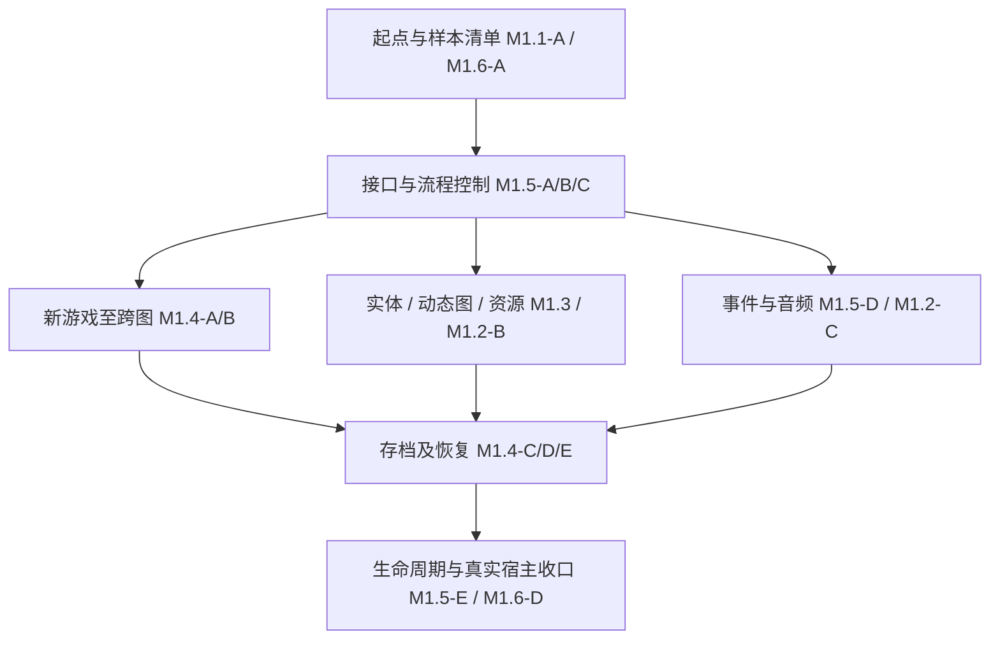

# M1 Implementation Plan / M1 实施任务与依赖

> Date / 日期：2026-11-22。
> Status / 状态：**阶段1（M1）实现完成，但验收未完成**（2026-11-22，来源：user）。自动回归已通过，ABI 2 流程/存档及建销已通过最终专项；实际证据见 §5，**人工尚未验收**。SUPERSEDED: 2026-11-18 的全项待实施状态。原任务表保留职责与完成条件，不以代码存在替代最终验证。
> Source / 来源：code（本仓 M0 实现与固定源码审计）；任务拆分为设计建议。
> Navigation / 导航：[M1 总览](README.md)、[桥接](M1_BRIDGE_CONTRACT.md)、[流程/存档](M1_FLOW_AND_SAVE.md)、[平台/音频](M1_PLATFORM_AND_AUDIO.md)、[验证](M1_VALIDATION.md)。

## 1. Change Surface / 实际改动落点

| 当前文件/职责 | M1 建议工作 | 边界 |
|---|---|---|
| `etndoom_mod/build_native.py:22`、`native/CMakeLists.txt:1` | 增量维护源码补丁、音频依赖、参考构建与锁文件 | 不手改 `core_source/` 后把生成目录当源码；补丁锚点必须校验 |
| `etndoom_mod/native/m0_core.h:8`、`m0_core.c:41` | 新游戏参数、流程/保存/读取请求、媒体与资源入口 | 头文件中的名字目前仍为 M0；实现前决定是否改名，不因阶段编号批量重命名 |
| `etndoom_mod/native/m0_observer.c:17` | 完整快照、无玩家状态、静态/动态数据及诊断 | 只读观察；不在这里补模拟或消耗 RNG |
| `etndoom_mod/native/m0_memory.c`、`build_native.py:73` | 新分配/文件/音频回调的销毁审计 | 当前 `SDL_Quit` 与 DLL 卸载仍须检验对新设备/线程的影响 |
| `etndoom_mod/gdextension/bridge.c` | 新符号/ABI、长度与类型校验、复制、主线程保护 | 继续直接使用 C GDExtension；不为 M1 改为通用框架 |
| `etndoom_mod/m0/session.gd:43,125,158,198` | 流程队列、world generation、事件消费、存档事务状态 | 不把 Godot 字典当内核存档；流程与输入分别校验 |
| `etndoom_mod/m0/screen.gd:100,138,173` | 各 gamestate 的控制、保存/读取、音频消费与状态显示 | 当前“读完全部 ack”只能处理生命周期事件；新增消费者后须按实际消费确认 |
| `etndoom_mod/entry/m0_entry.gd:160,192`、`build_m0.py` | 必需资源定位、打包清单、宿主音频与场景恢复 | 保留 M0 身份和产物溯源，不暗改本体加载器；新阶段包 ID/版本在落地时明确 |
| 本地 `tests/` | 扩展参考轨迹、完整流程和失败回归 | 仅本地保存，不提交 |

新模块如需拆文件，放在 `etndoom_mod/` 内；文件命名、包 ID 与 ABI 的迁移应在一次明确实现批次完成。阶段文档路径不强制生产代码路径同名。

## 2. Work Packages / M1.1–M1.6 工作清单

### M1.1 Build and Load / 承接构建与加载

| ID | 任务 | 产出/完成条件 | 依赖 |
|---|---|---|---|
| M1.1-A | 核验 M0 交付索引、宿主/源码包/工具链锁与当前 Git 状态 | M1 起点清单可定位到已验收 M0；保留本地在制品 | 已完成 M0 |
| M1.1-B | 规划 ABI 增量和包升级路径；锁新增源码/依赖 | 宿主能拒绝新旧不匹配；从本仓干净构建输出可追溯 | A、实际接口设计 |
| M1.1-C | 更新真实 ZIP 白名单与运行缓存清单 | 新包安装/重启加载正确构建，更新失败保留旧包 | B、M1.2 新依赖 |

M0 的最小建销与加载直接复用；只有修改到相关链路时重跑对应基线，最终收口统一验证。M1.1-C 不是再次从零比较 Source Port。

### M1.2 Platform and Resources / 平台与必需资源

| ID | 任务 | 产出/完成条件 | 依赖 |
|---|---|---|---|
| M1.2-A | 把已获准资源绑定为明确启动配置；核实 UTF-8、中文/空格路径、读写目录 | 内容/顺序身份稳定，缺失可诊断；禁 autoload 与静默回退保持 | M1.1-A |
| M1.2-B | 导出内核解析后的地图/纹理/flat/sprite 元数据与受限数据读取 | M2 所需数据能由同一资源视图取得，逻辑尺寸不受显示换皮影响 | M1.5-A/B |
| M1.2-C | 音频后端探针：实际 SFX + 音乐 + 暂停/停止 + 卸载 | 明确后端、依赖锁、线程/回调所有权；真实 ETN 有声音，原规则对照不漂移 | M1.1-B、M1.5-D |
| M1.2-D | 补系统服务与失败收口：文件、退出、时钟、错误、半初始化释放 | 缺文件/受控读写失败可返回；没有进程退出或残留回调 | A/C；完成后交 M1.5-E 统一验证 |

必要路径绑定可用开发配置/参数完成，不能因此自动实现资源浏览器、多 PWAD 排序或未经许可的搜索路径。改变获准 WAD 的位置/复制用途时继续遵守许可清单。

**2026-11-19 用户补充**：M1.2-A 必须接入 [M1-W01/W02](M1_VALIDATION.md#21-approved-additions--m1-新增获准资源2026-11-19)，分别回归纯 `doom.wad` 与 `doom.wad + dss/DSS.wad` 正常运行。需把现有固定 Doom II/MAP01 的 profile 和 `-warp` 参数适配为 Doom 的 episode/map 语义；DSS 要实际进入其 E2/E4 替换地图。参考端与移植端均允许该 PWAD 的内嵌 DEHACKED，不能沿用 M0 `-nodeh` 把补丁禁掉；外部 `DSS.deh` 仅参考，正常加载列表不含它。V20/V21 为必须回归项，V22 验证 DSS→纯 Doom 重建无补丁污染；通用 PWAD/外部补丁入口仍归 M3。

### M1.3 Gameplay / 玩法继承与可观察性

| ID | 任务 | 产出/完成条件 | 依赖 |
|---|---|---|---|
| M1.3-A | 保留固定 tic 与命令打包；核实 HUD/武器/玩家状态字段 | 输入不重放、不丢 tic，弹药/武器/钥匙/powerup 来自内核 | M1.5-A/B |
| M1.3-B | 为 mobj 创建/销毁/引用关系建立稳定观察 ID；导出完整实体 | 生成/删除可追踪，同地址复用不复用 ID；观察不改 thinker 顺序 | M1.5-B |
| M1.3-C | 补 sector/side 动态字段、specials 诊断和声音关联 | 门/升降/灯光/开关/传送在记录中可观察；原始整数可比较 | M1.2-B、M1.5-B/D |
| M1.3-D | 代表性移动、战斗、AI、拾取与机关差分 | 每类有合法样本和最早差异定位；问题修在依赖/接口层 | A–C、M1.6-B |

R04–R07/R11 的算法沿用上游；不能为了方便导出状态更换容器顺序、用 ETN 扫掠/命中补判，或以单图补丁替代原因定位。

### M1.4 Game Flow and Save / 完整流程与存档

| ID | 任务 | 产出/完成条件 | 依赖 |
|---|---|---|---|
| M1.4-A | 新游戏/难度/当前状态合法操作、死亡重生、明确重开入口 | 控制请求有完成/失败结果；死亡复活不被“整会话新开”掩盖 | M1.5-A/C |
| M1.4-B | 普通/秘密出口、结算确认、跨图携带、结束/返回 | 上游状态机走完整；诊断画面在非关卡状态仍可用 | A、M1.5-B |
| M1.4-C | 审计保存请求链、完整归档范围、RNG/调度/引用修复 | 补缺状态清单逐项有字段来源、保存和恢复顺序 | M1.3-B/C、M1.5-C |
| M1.4-D | 实现独立槽位、封套、事务写入/预检/读档失败策略 | 错误不覆写有效档；严格匹配身份；读档更新世界代次 | C、M1.2-D |
| M1.4-E | 暂停/失焦/载入期间 UI 与音频控制，350 tic 续跑差分 | 操作不依赖额外 gameplay tic；同图/跨会话恢复均有证据 | B/D、M1.2-C |

存读档与暂停的控制泵应尽早作为窄纵切打通；不能到全部玩法验证结束才发现暂停时保存永远排队。

### M1.5 Host Bridge / 宿主桥接与生命周期

| ID | 任务 | 产出/完成条件 | 依赖 |
|---|---|---|---|
| M1.5-A | 新接口声明、状态合法性表、结构/容量/错误契约 | 必需能力建会话前核验；无会话/失败会话拒绝非法操作 | M1.1-B |
| M1.5-B | 完整快照、地图、资源、流程状态；无玩家时仍返回合法流程快照 | 非 LEVEL 状态不访问失效玩家/地图；全量快照可重建消费者 | A |
| M1.5-C | 真实重建通知、三种时序身份、流程请求串行执行 | 同图重开/读档不会漏更新；换世界当批停止，旧命令清理 | A；与 M1.4-A 联调 |
| M1.5-D | 有界事件批次、实际消费后 ack、音频通道身份与重同步 | 不因重复读取重复播放，不静默丢关键事件 | A/B |
| M1.5-E | 暂停、失败返回、建销、回调结束与宿主恢复审计 | 输入/音频/资源/全局状态不泄漏；返回 ETN 可继续操作 | C/D、M1.2-C/D |

### M1.6 Inheritance Verification / 继承验证与交接

| ID | 任务 | 产出/完成条件 | 依赖 |
|---|---|---|---|
| M1.6-A | 样本与用途清单、未覆盖槽位、自动/人工责任 | 新样本有明确许可；旧图缺失不是“测试通过” | M1.1-A，可最先开始 |
| M1.6-B | 扩独立参考观察/输入轨迹和预期状态检查 | 参考保留上游调度；不复用待测 `step` 或恢复代码生成期望 | A、M1.5-B |
| M1.6-C | 运行分批矩阵与最早分歧诊断 | 功能、错误、长帧、音频、保存恢复逐项有证据 | 对应工作包完成 |
| M1.6-D | 真实发布版人工检查与 M2 消费交接 | M1-G1–G6 结论、真实字段样例、限制与可重现入口 | 全部核心工作包 |

## 3. Dependencies / 推荐批次与可检查成果

每批必须有可操作或可观测结果；自动用例受样本许可限制时仍可推进接口、假参数失败、数据容量和流程 UI 工作，相关玩法通过栏保留空缺。依赖图不要求新增并发模拟或工作线程。

## 4. Review and Handoff / 实施记录与交接格式

每个任务落地后补一行：`任务 ID / 实际文件:行 / ABI或schema / 实现状态 / 用例 ID / 本地证据路径 / 未覆盖项`。代码完成、自动通过、人工通过必须分开，不能把任务表勾选代替证据。

M2 交接最少包括：版本锁；从真实运行导出的地图/实体/流程/资源/音频样例；每类字段数值与生命周期；出生/传送/换图/读档的插值中断规则；失败返回和资源释放要求；首条可重现完整单人流程；原规则配置与跳跃配置的差异。

结构/逻辑实现完成后，集中同步 `ETNDOOM/ARCHITECTURE.md`、`ETNDOOM/SYSTEMS.md` 与 `PROJECT_MAP.md`。新坑写 `LEARNINGS.md` 并标来源；`WORKLOG.md` 只按用户明确要求记录。提交须先展示状态、差异及中文提交信息，经用户确认后再执行；推送由用户完成。

## 5. Implementation Record / 实际实施记录（2026-11-19）

Source / 来源：code | test。此表与阶段 Gate/人工状态分开维护，最终交付以最后构建哈希对应的汇总为准。

| 任务 | 实际落点 / schema | 实现与自动证据 | 尚需收口 |
|---|---|---|---|
| M1.2-A / M1.5-A | `native/m0_core.h`、`m0_core.c:m1_create` / ABI 2 | episode/map 显式参数、Doom/DSS 内嵌补丁、真实地图复核；保存专项实际进入 Doom E1M1、DSS E2M1/E4M1 | 真实宿主安装/参数反例已通过，见验收§8 |
| M1.4-A/E / M1.5-C | `native/m0_core.c:118`、`m1_control_status:56` / 请求 uint64 | new_game/restart_level/reborn/pause/save/load/confirm；`control_final2_20261119/summary.json` 自然死亡/结算、暂停重生与保存状态限制、confirm排队/完成/取消通过 | 宿主输入清理与人工交互按宿主专项收口 |
| M1.4-C/D | `native/m1_save.c:capture,restore,preflight,m1_save_slot,m1_load_slot` / 封套 schema 1 | 上游归档加补充状态、8 槽、SHA-256 身份/完整性、原子替换；完整字段审计见 [流程 §8](M1_FLOW_AND_SAVE.md#8-implemented-abi-2--实际控制与存档2026-11-19) | 最终构建静止/实战/机关/出口/跨图/按钮各点已通过 |
| M1.4-E / M1.6-C | 本地 `tests/m1_save_checks.py`、`m1_save_route_checks.py` | `save_final2_20261119/summary.json` 最终 5 组 × A/B/C/D/E ×350 tic一致，13类反例通过；`save_routes_final2_20261119` 运动门/出口前/跨图后三点各四支路通过，`save_button_final2_20261119` SR按钮五支路通过 | 人工存读档体验尚待验收 |
| M1.5-E / M1.6-C | 本地 `tests/m1_lifecycle_checks.py` | `lifecycle_final2_20261119/summary.json` 同进程50次DSS→Doom无规则/资源污染；分配归0、句柄增长0，暖机后工作集+763,904字节、private commit+1,966,080字节 | 原生30分钟墙钟长测由统一记录补充，真实宿主交互单列 |

上表不改写自然出口、结束流程、声音可听、真实 ETN 返回重进或人工验收状态；这些由对应专项与交付记录分别提供证据。

上述 `final2_20261119` 证据路径均位于本地 `tests/m1_results/`，统一核心 SHA-256 为 `0d0db6de55a422186ff28457269eb8d365842de614e29ad20453dc13e0988f26`。完整存档审计与历史失败/修复说明见 [流程 §8](M1_FLOW_AND_SAVE.md#8-implemented-abi-2--实际控制与存档2026-11-19)。
